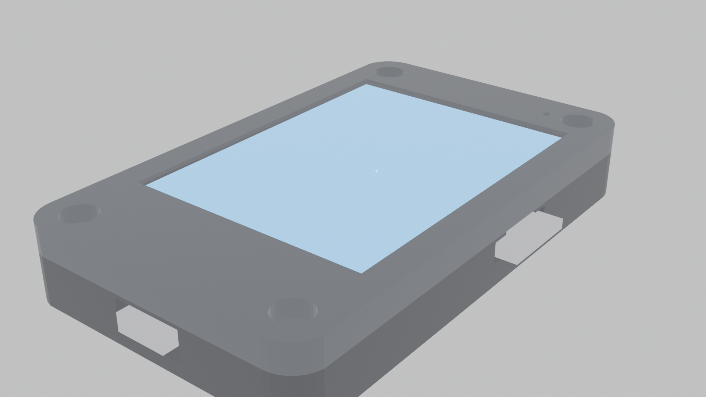

# Build an ESP32 classroom companion with an AI coding agent

**Shared teacher window:** `start_companion.bat` now opens Teaching Board and Voice
companion in one window, retaining the separate pupil presentation. See the
[guide](docs/2026-10-28-unified-desktop-guide.md) and
[implementation plan](docs/2026-10-28-unified-desktop-plan.md). Standalone Board
and voice launchers remain available for recovery.

**Current branch programme:** [holistic plan and completion dashboard](docs/2026-10-21-companion-media-agent-master-plan.md). We are continuing with the original ES3C28P ESP32-S3; its installed firmware stays stable/write-locked. The CYD application port is abandoned. The branch contains an isolated image-library candidate; live deployment and teacher acceptance are still open.

**Branches:** `main` is the stable reference. All current companion, Hermes and SQLite/media-library development is on `codex/companion-media-agent`.

**Permanent home/work connection:** the same Linux Hermes will be integrated over private Tailscale at both locations, while Groq remains primary. See [the connection runbook](docs/hermes-tailscale-home-work.md). The companion runtime Hermes adapter is implemented with local fixture/native UI checks; transport configuration and off-LAN acceptance remain open. See the [integration checkpoint](docs/2026-10-21-hermes-integration-checkpoint.md).

Start `start_companion_feature.bat` from the feature checkout for the isolated preview. Hardware inputs default off, feature data is separate, and the original stable board has not received feature firmware. See [testing/recovery](docs/feature-media-testing.md), [implementation evidence](docs/2026-10-21-media-feature-implementation.md) and [document index](docs/README.md).

Project agents can use the [Hermes collaboration skill](.agents/skills/hermes-collaboration/SKILL.md) for the configured Linux API. Credentials and connection details stay in ignored local storage.



A small touchscreen device for Bluetooth shortcuts, push-to-talk AI conversations, and spoken writing on a Windows PC. This repository contains the firmware, host receiver, Windows Compose companion, hardware references and enclosure models for the **LCDWIKI / QD Electronic ES3C28P ESP32-S3 board**.

This guide shows how to take the project from a downloaded repository to a working device, using **Cursor or local Codex for development**, **USB for programming the ESP32**, and **Blender MCP to help design and refine its enclosure**.

**[Follow the detailed build guide](docs/build-guide.md)** · **[Hardware and pinout](docs/hardware-reference.md)** · **[Enclosure files](docs/dimensions/)**

## The development process

The project grew through a repeated cycle: describe a useful task, turn it into a small implementation plan, let an IDE agent help write the code, test it on the physical device, and use the results to make the next change.

There are two hands-on parts to that process:

- **Electronics and software:** the agent reads and edits the local repository, runs PlatformIO, uploads firmware over USB and helps interpret serial logs. You test the screen, buttons, Bluetooth and audio.
- **Mechanical design:** the agent uses Blender MCP to inspect and change an enclosure in Blender. You check dimensions against the board and battery, inspect the exported model in a slicer and test the printed fit.

Start by getting the existing firmware working. Add your own features and enclosure changes once you have a baseline you can return to.

## What connects to what?

| Connection | Purpose | How you make it |
|---|---|---|
| Development computer to ESP32 | Build, upload firmware and read logs | USB data cable and PlatformIO |
| ESP32 to the computer being controlled | Send keyboard shortcuts and media keys | Pair `ESP32 MacroPad` over Bluetooth |
| ESP32 to the Windows Compose companion | Compose, Dictate, and Paste Ready on the focused document | Bluetooth keys from the Compose & Dictate page; the PC microphone does the recording |
| ESP32 to voice receiver | Send recorded speech and receive replies | Wi-Fi to the host receiver on TCP port 8787 |
| Local IDE agent to Blender | Inspect and edit the enclosure | Blender MCP server plus Blender add-on |
| Voice receiver to AI backend | Transcribe speech and obtain a reply | Local Python receiver, Hermes and/or Ollama |

Blender MCP controls Blender. Firmware uploading uses PlatformIO. For the simplest setup, run the IDE agent, Blender and PlatformIO on the computer with the ESP32 plugged into it. A hosted coding session needs a separate, explicit connection to that computer before it can access its USB device or Blender.

## What you need

- **ES3C28P board:** ESP32-S3, 16 MB flash, 8 MB PSRAM, 2.8-inch (about 71 mm diagonal) 240 × 320 touchscreen and ES8311 audio hardware. The firmware is configured for this board; other ESP32 touchscreen boards need their own pin mapping and drivers.
- A USB **data** cable, a computer and Bluetooth support on the computer you want to control.
- Git, PlatformIO Core, and Cursor or a local Codex client with access to the project folder and terminal.
- For enclosure work: Blender, Blender MCP and a slicer; a 3D printer if you want to print it.
- For voice: Python, `faster-whisper`, Wi-Fi, and a configured Hermes installation and/or local Ollama model.
- For Compose and Dictate: Windows, the companion in [tools/compose/](tools/compose/), and the PC microphone. Cloud speech and writing use Groq; with no key, or with `LOCAL_ONLY=1`, the companion uses local Whisper and Ollama. Live web lookup for Compose also needs a Brave Search key.
- Optional: a compatible 3.7 V single-cell rechargeable battery and microSD card.

## 1. Download and open the project

In your terminal:

```bash
git clone https://github.com/dsuth10/ESP32-project.git
cd ESP32-project
git switch -c my-classroom-companion
```

Open this folder in your IDE. The main firmware is the **root PlatformIO project**, configured by [platformio.ini](platformio.ini); `esp-idf-lvgl/` contains a separate reference/demo project.

Give the agent a specific first task:

> Read README.md, docs/build-guide.md, platformio.ini, GEMINI.md and the relevant source files. Explain the build environment, USB connection and configuration I need for this ES3C28P board. Check the installed tools and list connected serial ports before changing anything.

[GEMINI.md](GEMINI.md) records engineering constraints learnt during development. Ask whichever agent you use to read it explicitly.

## 2. Connect the ESP32 over USB

Plug the board's USB-C/native USB connection into the development computer using a data cable. Then run:

```bash
pio device list
```

On Windows, check **Device Manager → Ports (COM & LPT)**. Supply the detected port explicitly. Uploads also verify the registered physical board, processor, flash capacity and firmware manifest; a COM number alone is insufficient. The original stable board is write-locked. See [board upload safety](docs/board-upload-safety.md).

The [build guide](docs/build-guide.md#3-connect-the-board-build-and-upload) includes bootloader recovery if the board does not appear.

## 3. Configure, build and upload

**Board safety:** the original S3 remains write-locked. Use isolated host-side previews with unchanged firmware where possible; any S3 firmware trial requires explicit approval and verified recovery. The CYD is no longer our application test target. See [the guarded workflow](docs/board-upload-safety.md).

Copy the credentials template to a local configuration file. On Windows PowerShell:

```powershell
Copy-Item src/wifi_config.h.example src/wifi_config.h
```

On Linux/macOS:

```bash
cp src/wifi_config.h.example src/wifi_config.h
```

Fill in your own Wi-Fi names, passwords and receiver addresses. The local file is excluded by `.gitignore`. For Bluetooth-only testing, use valid C strings with placeholder network values until you are ready to configure voice.

Build and perform a read-only preflight first. Replace `COM5` with the explicitly identified port. Actual uploads remain governed by the stable-device trial/release gate:

```bash
pio run -e esp32-s3-portrait
python tools/board_safety.py check --profile es3c28p-s3 --port COM5 --manifest .pio/build/esp32-s3-portrait/board-upload.json
pio device monitor --port COM5 --baud 115200
```

Close the serial monitor with **Ctrl+C** before uploading again. The default interface is portrait; the legacy landscape build uses environment `esp32-s3-devkitc-1`. See [the orientation guide](docs/PORTRAIT_UI.md).

**Checkpoint:** the screen boots, touch navigation responds and serial logs are readable.

## 4. Pair Bluetooth and try a shortcut

On the computer you want to control, open Bluetooth settings, add a device and select **ESP32 MacroPad**. Open a disposable text document and test Copy, Paste or Enter. Test volume control separately.

The current profile order in [src/macropad_config.cpp](src/macropad_config.cpp) is:

| Profile | What it does |
|---|---|
| System | Connection dashboard, Home/Work selection, volume and power controls |
| Media & Audio | Playback, mute, track and volume controls |
| Productivity | Copy, paste, undo, select all, save and cut |
| Windows Tools | Windows shortcuts such as Snipping Tool and File Explorer |
| Custom Keys | Configurable key combinations, Enter and Shift+Enter |
| Hermes Voice | Hold-to-talk, reply display, chat scrolling and audio toggle |
| Compose & Dictate | Spoken writing, speech-to-text, and Paste Ready |
| Storage Explorer | Browse a microSD card |

These are the source profile names; older plans use different page numbers. Some shortcuts are Windows-specific and may need adapting for another operating system.

**Checkpoint:** a touch on the device causes the expected action on the paired computer.

### Compose, Dictate, and Paste Ready

The **Compose & Dictate** page is a Windows writing remote. It does not use the ESP32 microphone or the Hermes voice receiver. The device sends Bluetooth keys; [tools/compose/start_compose.bat](tools/compose/start_compose.bat) must be running on the PC you are writing into. That companion records the PC microphone, then pastes plain text at the cursor.

Leave an editable document focused, open the Compose & Dictate page, then:

| Control | Gesture | What you get |
|---|---|---|
| Compose | Tap to latch, tap again to finish; or hold to talk and release to finish | The words you spoke, turned into the writing you asked for |
| Dictate | Same tap or hold | Your speech as text, with light punctuation and capitals |
| Paste Ready | A short tap | Inserts a result that was held because the document lost focus |

A tap under about 350 ms latches recording and lights the button. A second tap anywhere on the screen finishes it. Holding the button is push-to-talk and stops on release. Recording stops by itself after 60 seconds. The same actions work from the companion window, and from the keyboard as F13 / Ctrl+Alt+Shift+F9 (Compose), F14 / Ctrl+Alt+Shift+F10 (Dictate), and F15 / Ctrl+Alt+Shift+F11 (Paste Ready).

**Compose** treats the transcript as an instruction. You can ask it to draft a paragraph, answer in prose, or rewrite text you have already highlighted. Highlighted text is read with Windows UI Automation and sent as context, so “make this shorter” or “fix the grammar” applies to the selection. Output is Australian English and plain text meant to land straight in the document: no “here is your draft” wrapper, and no markdown unless you asked for it. A long answer can continue for up to four extra writing passes. If the request is about something current — today’s weather, news, a score, “look this up” — and web search is enabled with a Brave Search key, Compose can attach a few live search snippets before it writes. A straight rewrite of selected text skips that search. Dictate never searches. If the network blocks Groq, that session stays on local Whisper and Ollama after the first fallback.

**Dictate** is speech-to-text, not a writing assistant. “Write an essay on biology” becomes that sentence, not the essay. A cleanup pass may add punctuation, capitals, and sentence breaks in Australian English. If the cleanup changes too many words, or grows or shrinks the transcript by more than about half, the companion keeps the original transcript instead.

**Paste Ready** is the hold queue. When the same window and control are still focused, Compose and Dictate paste immediately with Ctrl+V, then put your previous clipboard contents back. If you switch windows while it is working, the text stays queued and the status shows ready to paste. The companion's Compose, Dictate and Paste Ready buttons can return to the last external document window after checking its process and title. An automatic result never restores a window you left while processing. You can also focus the document yourself and use the hardware Paste Ready control. An empty queue does nothing to the document. A successful key injection means Windows accepted the paste; a given app can still ignore it.

Copy [tools/compose/compose.env.example](tools/compose/compose.env.example) to `compose.env` in that folder before relying on cloud speech, cloud writing, or web search. Closing the companion stops the microphone and the hardware listener. It does not start automatically at Windows sign-in.

### Embedded assistant and reusable writing

Run `start_companion.bat`, choose **Voice companion**, then open **Ask your companion**. **Ask / write** answers text requests; **Manage companion** can inspect limited live companion status and save text. It reuses your Groq configuration, with optional `GROQ_ASSISTANT_MODEL`. Without a Groq key, or with `LOCAL_ONLY=1`, it uses your configured Ollama endpoint. Management needs a model supporting tool calling. This assistant tab has no live web search; Compose retains its existing optional search path.

**History & saved text** retains new Compose, Dictate and assistant text on this Windows account. Search previous results, save useful responses, copy, export or delete individual entries. **Queue for Paste Ready** holds the selected response; focus your document and use the hardware/keyboard Paste Ready shortcut to insert it. Queueing does not paste into the companion.

The database normally lives at `%LOCALAPPDATA%\ESP32ClassroomCompanion\companion.sqlite3`, outside this repository. It contains request/response text, not raw recordings. Set `HISTORY_ENABLED=0` in `compose.env` to disable automatic history on startup, or use the session checkbox. Explicit **Save** operations still retain the text you choose. Deleting local History does not erase any content already sent to an AI provider. The assistant searches stored History only when **Allow History search for this request** is selected in Manage mode; matching text then goes to the selected AI. Recent conversation context is scoped separately to Ask and Manage and resets with **New conversation**.

This first version cannot alter handheld buttons/pages, flash firmware, run shell commands or repair arbitrary faults. It reports that boundary instead of claiming a device change. Existing recording, Bluetooth shortcuts and receiver behaviour are retained. See [the implementation notes](docs/2026-10-21-companion-assistant-first-increment.md).

## 5. Make a small change with your IDE agent

For example:

> Change one Custom Keys button to send Ctrl+Shift+M and label it MIC TOGGLE. Preserve the existing layout, touch handling and other profiles. Build the portrait firmware, show the diff, then upload to my detected USB port. I will test whether the target application recognises that shortcut.

The agent can help edit, compile, upload and diagnose. The physical test tells you whether the change actually works in your application. Save a working commit before tackling a larger feature.

Opening an application on a particular monitor or navigating to a OneNote page needs host-side automation as well as a device trigger. The [OneNote automation plan](docs/ESP32_Classroom_Companion_OneNote_Automation_Plan.md) describes that proposed extension.

## 6. Connect Blender MCP and refine the case

Open [docs/Case.blend](docs/Case.blend) or an appropriate battery enclosure in [docs/dimensions/](docs/dimensions/), and save a working copy.

Install the Blender MCP add-on and configure it in **either Cursor or Codex**, following the [Blender setup steps](docs/build-guide.md#6-connect-blender-mcp). Verify the connection with a simple request to list scene objects before asking the agent to change the case.

Then try:

> Inspect the enclosure and report its dimensions in millimetres. Compare it with the supplied board drawing and my measured board. Preserve the screen opening, USB access, microphone opening and mounting points. Propose the changes needed for my measured battery before editing. Save a separate Blender file and export each printable shell separately.

Use the [dimension drawing](docs/dimensions/ES3C28P_Size.pdf), your actual hardware and the supplied models as references. Check the STL size in the slicer: changing Blender's display units alone does not prove the export scale is correct.

The existing [top and bottom STLs](docs/dimensions/case_stl/) are a starting point. `Full_Enclosure_Assembly.stl` includes reference electronics and is for inspection; print the shell parts separately.

**Checkpoint:** the agent can inspect Blender, and your exported parts have the expected dimensions and clearances.

## 7. Add voice once the basic device works

The ESP32 records speech; the host computer runs transcription and AI processing. Start on the same local Wi-Fi network.

Follow [the receiver setup](docs/build-guide.md#5-set-up-the-optional-voice-receiver) to install dependencies, configure authentication, start the service and test its health endpoint.

The production receiver retains its existing routing until an approved integration trial. Historically Home tried Hermes first and Work tried local Ollama first; that is not the new permanent-route design.

The branch target uses the same Linux Hermes over Tailscale from both locations, with Groq primary for the desktop assistant and explicitly selected local-only operation available independently. A local-only mode must suppress remote Hermes too. See [home/work architecture](docs/home-work-architecture.md) for the target and [the permanent connection runbook](docs/hermes-tailscale-home-work.md) for its still-pending setup/acceptance. A reply alone does not prove which backend handled it; preserve backend provenance and independent readiness indicators.

**Checkpoint:** hold the talk button, speak a short question, release it, and receive a transcription and reply.

## 8. Test, print and keep improving

Test USB boot, touch, Bluetooth, voice, profile switching and battery operation separately. A successful build checks the software; it cannot check a printed fit, microphone opening or battery connection.

For a battery, verify the connector, polarity and charging requirements against the [board manual](docs/user_manual.pdf) before connecting it. Measure the battery and leave room for its lead and connector.

Keep each improvement small enough to test and explain. Record your tool versions, working firmware commit and print settings so the next person can reproduce your results.

## Further reading

- [Detailed build guide: tools, agent prompts, USB, Blender MCP and troubleshooting](docs/build-guide.md)
- [Compose and Dictate repair notes](docs/Compose_Dictate_Repair_2026-10-17.md) — how Page 6 is meant to be used day to day
- [Hardware identification and pinout](docs/hardware-reference.md)
- [Home/Work architecture design notes](docs/home-work-architecture.md) — compare design intentions with the current receiver routing described above
- [Portrait upload and landscape restore](docs/PORTRAIT_UI.md)
- [Board schematic](docs/schematic.pdf) and [user manual](docs/user_manual.pdf)
- [Enclosure generator](generate_case.py) and [render scripts](render_views.py)

The enclosure scripts contain machine-specific output paths. Read and adapt them before running them. The main firmware uses Arduino through PlatformIO, TFT_eSPI for drawing, and the bundled board drivers; installing Blender MCP does not add an ESP32 programming tool.
