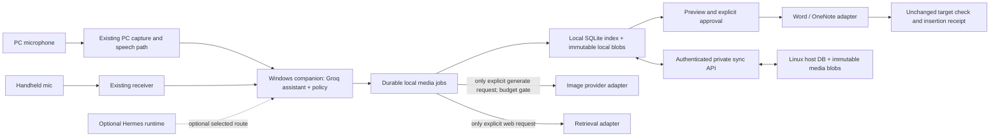

# Classroom companion media agent: master plan

21 October 2026

**Status: implementation authorised; isolated feature candidate under test.** The user subsequently confirmed implementation on a new branch while retaining main/live firmware. This document records the planning baseline and twelve confirmed product choices; its pre-media state matrix is historical. Current code, tested deviations and outstanding acceptance gates are recorded in the [implementation record](2026-10-21-media-feature-implementation.md) and [testing guide](feature-media-testing.md). The separate media database preserves the existing History schema rather than migrating the live text database. No paid image generation or live service deployment has occurred.

## Confirmed decision register

| # | Confirmed choice | Consequence for this plan |
|---|---|---|
| 1 | OneNote and Word first; PowerPoint next. | First supported target work is independent Word and OneNote desktop acceptance. PowerPoint follows after those gates. |
| 2 | Prep and Live are both available, with Library as the default. | Users can manage assets without a document open or work in a current target. Always show which mode is active. |
| 3 | A retrieved asset may be inserted on explicit request into an unchanged target. A generated asset must be previewed before insertion. | Recheck target identity/focus immediately before insertion. Generation cannot auto-insert. |
| 4 | Check the library first. Search the web only when explicitly asked; if no suitable result exists, ask before generating a replacement. | “Find” means search the user’s library first. Do not silently invoke search or generation. |
| 5 | Image pilot has an A$30 monthly design budget. | Use this design allowance for estimates, reservations and receipt reconciliation; it is not a guaranteed invoice ceiling or permission to spend. No generation or paid trial has happened. |
| 6 | Automatic home/work sync is required in the first release. | Sync is a first-release dependency, not a later enhancement. Release requires a working two-host test. |
| 7 | Sync media and metadata only. Keep History, credentials and network settings local. | Existing text History must not be mirrored. Asset generation prompts stay local and are not silently treated as synced metadata. |
| 8 | Host the private library service on the user’s Linux machine alongside Hermes; prefer Tailscale. | Use a private authenticated API and per-device local stores. Tailscale is a preferred private route, not yet a proved work-network route. |
| 9 | Support both microphone paths in the same full release: PC microphone first, handheld receiver integrated. | Both inputs must reach the same media job workflow and policy checks. |
| 10 | Groq remains the embedded assistant’s primary provider; Hermes is optional. | Preserve the working direct Groq path. Linux library hosting does not make Hermes a mandatory conversation engine. |
| 11 | “Keep this named canonical” preserves immutable versions; later revisions never replace it automatically. | Canonical selection is an explicit, versioned action. Concurrent conflicting canonical choices require resolution. |
| 12 | Complete the image workflow first. Audio/video and new handheld customisation come later; preserve all current functionality. | Image-only scope through the release gate; retain existing firmware controls, Compose/Dictate, assistant, History, receiver and launch behaviour. |

## Current state: evidence, gaps and limits

The following reflects the repository and the recorded first-increment QA. The reported **90-test integrated result is historical evidence and was not rerun for this plan**. It establishes the assistant/History slice described below, not media, target-app insertion, private sync, the current handheld firmware, or classroom acceptance.

| Area | Exists in the current tree | Partial / limitation | Missing for this plan |
|---|---|---|---|
| Desktop assistant | `tools/compose/assistant_panel.py` and `assistant_service.py` provide Ask/Manage chat. Groq uses existing companion configuration; Ollama is the local-only fallback. | Ask and Manage are separate; current Manage tool allowlist is small. No MediaProvider or durable media-job lifecycle. | Media intent tools, explicit retrieval/generation gates, durable jobs and provider adapter. |
| Local text History | `tools/compose/history_store.py` owns schema v1 SQLite; `library_panel.py` and `compose_gui.py` expose text History and saved text. Default location and local opt-out/retention controls are described in the first-increment note. | Schema contains text request/response records, not asset binaries or media provenance. Local DB is not application-encrypted. | Additive versioned migration and separate asset/blob model. Keep History local. |
| PC microphone | `audio_capture.py`, `speech_pipeline.py`, `compose_gui.py`, and `llm_pipeline.py` implement capture, STT, text generation, focus snapshot and queued insertion. | Current output is text. Existing result queue and focus check do not identify a document caret or prove an insertion. | Route a PC-spoken media request into the same durable media job service without disrupting text actions. |
| Handheld microphone | Firmware voice action and `server/hermes_voice_receiver.py` provide a separate device-audio receiver path. `receiver_service.py` manages the Windows process. The recorded host observation found HTTP 200 `/health` on local ports 8642 and 8787. | Liveness does not prove authenticated Hermes sessions, model readiness, audio acceptance, or the exact Linux/Hermes host mapping. It is not connected to the desktop media job model. | Pass a device transcript/request to the app-owned intent/job boundary with the same gates as PC speech. Keep existing receiver response path functional. |
| Library UI | `library_panel.py` is a text History panel. | “Library” is currently text History, not an image asset browser. | Asset gallery, search/filter, preview, status, canonical label, version lineage and insertion queue. |
| Image/media | None found in the reviewed companion sources. | Existing docs define a candidate data model only. | Local import, safe preview, immutable versions, provenance, web lookup (explicit only), generation and refinement, approval and insertion. |
| Clipboard/focus | `clipboard_manager.py` copies Unicode text and sends Ctrl+V. `focus_tracker.py` captures foreground identity and checks it later. | No generic image clipboard contract, caret API, selection semantics, app save/reopen evidence or duplicate prevention. | App-specific Word and OneNote adapters and real target-app verification. |
| Device customisation | `src/macropad_config.h/.cpp` define compile-time UI/actions. Existing receiver offers voice, and current buttons remain. | No general runtime profile schema, authenticated config transport, capability handshake or revision acknowledgement. | Explicitly out of this image release; preserve current firmware and defer new controls to later work. |
| Hosting/sync | Current local services and the Linux Hermes host are separate. Parent’s host check found the Tailscale client running and one Linux peer online. | These observations do not verify which peer maps to Hermes, private library API authentication, certificate identity, Tailscale ACLs, or work access. | Authenticated Linux media API, durable storage/backup, per-Windows-client local DB/cache/outbox, automatic sync and recovery. |
| Verification | First increment recorded 90 integrated tests, a synthetic live Groq Ask and status tool call, and native UI preview. | No hardware build/flash or physical target-app paste acceptance was done in that increment. | New tests plus manual Word/OneNote acceptance, two Windows hosts, Linux sync host, failure/recovery and physical microphone paths. |

Sources: [first increment report](2026-10-21-companion-assistant-first-increment.md), [embedded design](2026-10-21-embedded-companion-assistant-design.md), [media insertion investigation](research/2026-10-21-media-library-insertion-investigation.md), [media sync investigation](research/2026-10-21-media-sync-investigation.md), [Hermes/Groq investigation](research/2026-10-21-hermes-orchestration-investigation.md).

## Product boundary and proposed architecture

The companion owns the user-visible workflow, local records and insertion intent. Groq is the primary embedded assistant provider for interpreting speech and coordinating bounded app operations. A provider adapter may render images; it cannot approve them or write to a target application. The Linux service authorises and commits shared media/version metadata and canonical choices proposed by a desktop. Managed draft versions can synchronise so refinement can continue on another computer; approved/canonical assets are prefetched for dependable offline retrieval. Hermes remains an optional separate agent/runtime and is not the media library database, credential store or policy authority.

**Engineering proposals, not confirmed policy:** separate provider interfaces `AssistantModel`, `ImageProvider`, `WebRetriever`, `TargetAdapter`, and `SyncClient`; typed operations with bounded arguments; local persistence before remote dispatch; idempotency keys for writes; explicit cancellation/failure states; no shell or arbitrary SQL tools; no automatic cloud fallback when local-only is selected. A future API adapter must detect supported capabilities and fail closed if the selected server cannot provide the required behavior.

The live/current-target path and prep/library path use the same assets, version identities and approval semantics. “Library-first” is a deterministic application lookup, not a model’s unverified recollection. The model may propose a match; the app returns candidates with title, preview, source, canonical status and rights notes for the user to choose.

## Voice-to-image workflow

1. **Capture.** User speaks through PC mic or handheld mic. Existing STT paths return a transcript. Show the transcript/request and microphone route. Do not persist raw audio. Both routes call one app-owned media command interface; receiver health is never mistaken for job completion.
2. **Resolve intent.** Groq classifies a bounded intent (find/reuse, import, create, refine, approve/name canonical, insert, or cancel). Ask a short clarification only where destination, subject, class/audience, or output size materially changes the result. “Find our water-cycle image” searches the library. “Generate a new water-cycle image” explicitly requests generation. Existing matches may be offered without silently substituting them for a requested new image. Do not search the public web unless explicitly requested. When a retrieval request has no suitable result, ask before changing it into a paid generation request.
3. **Target snapshot.** Library/prep mode can proceed with no document open. Live mode captures application process/window identity and visible target details. The target must be unchanged at insertion. A target change pauses the job and asks the user to reselect; do not steal focus or type into whichever window happens to become active.
4. **Acquire.** Import copies the chosen file into managed storage and validates detected MIME/size. Library reuse selects an existing asset version. Explicit web search records candidate URL, creator/rights evidence, retrieval time and attribution; result visibility is not a licence. Generation is a distinct user request: show the resolved brief, provider/model and estimated spend/budget impact. Once the implementation and spending policy are approved, an explicit generation request within the authorised allowance can proceed without another modal confirmation. Ask when the brief or spending authority is actually missing. An ambiguous timeout is reconciled by provider job ID/idempotency key or shown as “needs recovery”; never auto-submit a new billable generation.
5. **Preview and refine.** Show a locally rendered preview and provenance. For generated output, preview is mandatory before insertion. Conversational edits create a linked immutable child version and a new preview; never overwrite parent bytes. One change per refinement turn is preferred for auditable comparison. A failed edit leaves the prior version available. A teacher reviews science, spelling, accessibility and licence before approval.
6. **Name and canonicalise.** “Keep this as our water-cycle image” creates or updates the asset’s canonical pointer to the chosen immutable version with a recorded user action. Permission to insert a previewed draft is separate from naming it the canonical library version. A later edit becomes a new revision; it cannot replace the pointer automatically. If offline devices choose different canonical versions, sync preserves both candidates and marks a conflict for user resolution—no silent last-writer-wins.
7. **Insert.** On explicit insertion request, verify that the previously captured target is still unchanged. Retrieve/imported image may be inserted without a second preview if the user’s request was explicit and the target remains unchanged; generated image always requires preview before insert. Show queued asset/version and destination. Use a target-specific operation, then record transport and verification level. “Clipboard set” or “adapter call returned” is not proof the picture is embedded or saved. Keep a retryable receipt; prevent duplicate insert on uncertain response until reconciled.
8. **Sync.** Once local blob and metadata are committed, automatic sync queues them to the private Linux API. UI shows local/syncing/synced/conflict/unavailable. Sync acknowledgement means server committed bytes and metadata only; it never means Word/OneNote accepted insertion. Offline clients keep usable cached copies and retry safely when connected.

## Data model and v1 migration proposal

Keep the existing History schema and data unchanged. Introduce a transactional, additive migration from database `user_version=1` to `2` (or the project’s actual migration convention once verified) that creates independent media tables and indexes. Back up the local DB first; validate existing History row counts before/after. Keep SQLite local to each Windows machine and to the Linux service process. Never mount/open server SQLite from a desktop client or sync its `.db`, WAL or SHM files; SQLite documents network-filesystem hazards and WAL’s same-machine shared-memory requirement ([SQLite network use](https://www.sqlite.org/useovernet.html), [WAL](https://www.sqlite.org/wal.html)).

Proposed entities:

- `asset`: stable UUID, media kind/MIME, user title, caption/alt text, tags, created time, canonical-version pointer and lifecycle state.
- `asset_version`: immutable UUID, SHA-256, byte length, detected MIME, dimensions, managed relative blob path, parent version, transformation/tool version, created time and approval state. Every edit/resize/crop is a child version.
- `provenance`: source kind (import/generated/web/derived), creator/provider/model or source URL, licence evidence/attribution, retrieval/generation time, generation request ID and usage/cost receipt where available. Keep full image prompt and conversational refinement transcript in a **local-only** table keyed to the version; do not sync them by default.
- `media_job`: durable job UUID, input route, intent, state, safe progress, selected asset/version IDs, provider operation ID, idempotency key, cancellation/recovery information and timestamps. Do not copy History transcript into this record.
- `insertion_intent` and `insertion_receipt`: asset/version, target adapter and captured target identity, requested operation, state/expiry, provider-independent result, target app/version, timestamp and verification level. Avoid document body text.
- `sync_event` / `sync_cursor` / `sync_conflict`: immutable event UUID, device ID and sequence, object IDs/hashes, parent/base version, state, server cursor and conflict choices. Credentials remain in Windows Credential Manager/DPAPI and server secret store, never in DB events or media files.

Write blobs to a temporary managed path, flush/verify size and hash, atomically rename, then commit metadata. Reconcile orphan blobs/rows at startup. Exact-byte hashes deduplicate storage but do not prove ownership or permission. Keep local cache of approved/canonical assets for offline use. Tombstones and reference checks must protect blobs referenced by assets, versions, pending sync, receipts or backups.

### Sync API contract (proposal only)

The Linux host runs a small authenticated media API beside Hermes, with its own service account, directories, database and backups. App clients communicate over HTTPS on LAN or private tailnet path. API endpoints below are conceptual names, not implemented contracts:

- `POST /v1/sync/events` — submit immutable event(s) with event UUID and idempotency key; server validates device permissions and metadata schema.
- `PUT /v1/blobs/{sha256}` — resumable or chunked upload; server checks maximum size, content hash and detected type before commit.
- `GET /v1/blobs/{sha256}` — download only authorised object; client verifies hash before marking locally available.
- `GET /v1/sync/changes?cursor=…` — return changes/cursor; clients scan after restart as notifications are hints only.
- `POST /v1/sync/ack` — acknowledge event/cursor after commit; no desktop DB file transfer.
- `GET /v1/capabilities` — identify the library service/version and supported sync contract before a desktop applies changes.
- `POST /v1/budget/reservations` and `POST /v1/budget/receipts` — coordinate the shared image allowance without uploading prompts or provider credentials.

Use per-device credentials and server-side authorisation in addition to Tailscale network membership. Prefer a stable local hostname and Tailscale DNS identity; configure private Serve if appropriate. Do not use Funnel, public port forwarding or unauthenticated file shares. Revoke a device credential and confirm it can no longer sync. Home host offline means local library remains available; never report an upload as accepted until the API acknowledges commit. The current observation of a running Tailscale client and online Linux peer is not evidence of correct peer mapping, ACLs, API identity, certificate validation or school access. School/network acceptance remains a gate. Sources: [Tailscale Serve](https://tailscale.com/docs/features/tailscale-serve), [access controls](https://tailscale.com/docs/features/access-control), [Funnel](https://tailscale.com/docs/features/tailscale-funnel).

## Providers, quality and budget boundary

Use Groq as primary assistant/orchestrator, per the confirmed choice. Its documented vision accepts image inputs for analysis/OCR, but the checked official model catalogue shows text outputs; do not claim Groq provides image generation. Image creation/editing therefore needs a separately configured provider adapter. Hermes remains optional, with explicit route selection and capability/auth checks. Its image tools are not an app-owned canonical library and its persistent session history is not this companion’s History. Do not send prompts/assets to Hermes implicitly.

The provider investigation recommends a later small synthetic water-cycle evaluation of OpenAI GPT Image 2.5 Sunburst and Google Gemini 3 Pro Image; official pricing units and feature limits are recorded in [the provider research](research/2026-10-21-image-provider-investigation.md). Use those docs for detailed rates rather than copying a stale flat “per image” claim here. Image generation may be expensive and scientific labels/arrows can be wrong. Prefer a deterministic, teacher-reviewed vector diagram for facts/labels if model rendering fails evaluation; image generation may supply decorative elements.

The A$30/month pilot is the agreed **image-generation design allowance**, not spending authorisation or a guarantee about provider billing. Before a future paid test, resolve the exact provider/model, estimated usage, remaining budget and currency/tax basis. Proposed enforcement reserves a conservative upper bound before dispatch and reconciles the returned usage receipt. Stop before submission if the cost cannot be bounded or the allowance is exhausted; offer an explicit override rather than silently exceeding it. Provider charges may be in USD, and conversion, tax, uncertain in-flight charges or delayed receipts prevent a purely local estimate from guaranteeing an exact AUD invoice cap. Record provider usage and the dated conversion basis; never invent an exchange rate. Existing server, storage or Tailscale costs are separate from the image pilot allowance.

The budget ledger and reservations must be shared through the Linux service, because two computers must not each spend the same remaining allowance. Credentials and prompts remain local; the shared ledger needs operation IDs, estimates/usage, currencies and model identifiers, not chat text. If the shared budget authority is unreachable, cached retrieval and local preparation remain available and new paid jobs wait. Reserve uncertain attempts until reconciled; do not automatically issue another generation after an ambiguous timeout. The first end-to-end infrastructure trace uses an imported image and incurs no image-generation spend.

## OneNote and Word insertion boundaries

Current Ctrl+V path is text-only. Image clipboard formats are not yet part of the app and even a clipboard write would not establish durable document insertion. A target adapter must be selected and exercised per app/version. Word desktop VBA `InlineShapes.AddPicture` accepts a path, link/save behavior and range, making it a candidate for an explicit caret operation; it still needs local policy, selection, undo, file-embedding and save/reopen tests ([Microsoft Word API](https://learn.microsoft.com/en-us/office/vba/api/word.inlineshapes.addpicture)). OneNote desktop has a page-update object model, while OneNote Graph mutates a cloud page and does not identify the active desktop caret; these are separate adapters requiring consent, identity and placement decisions ([OneNote Application interface](https://learn.microsoft.com/en-us/office/client-developer/onenote/application-interface-onenote), [Graph page update](https://learn.microsoft.com/en-us/graph/onenote-update-page)).

**Proposal:** first choose and verify a narrow desktop insertion mechanism for both named targets, with no document text extraction by default. If an API cannot reliably determine the current insertion point, use a safe user-driven handoff (preview, explicit target selection, then app-level insert) and describe its verification honestly. Do not claim a generic “insert at cursor” API. Treat a selected text range separately; never replace a selection without an explicit operation. Verify each installed Office edition, architecture, security policy, OneNote variant, notebook/page context and whether media is embedded or linked.

The interface should keep the companion responsive and readable: active mode (Prep/Live), current target name, job stages with cancellable progress, preview, version/canonical state, source/rights and cost if applicable, sync status, retry/recovery action. Preview or queue updates must not steal focus from the target. Provide accessible keyboard navigation, clear labels alongside colour, scalable text, focus order and screen-reader descriptions.

## Durable jobs, retries and failure handling

Persist a job before starting any network/provider operation. Suggested job phases are `queued → resolving → acquiring → preview_ready → insert_queued → inserting → completed`, with `awaiting_user`, `failed`, `cancelled` and `needs_recovery` branches. Keep insertion authorisation, canonical approval and sync status as separate fields: an image can be inserted locally while its upload is still pending, and approving a named version does not insert it. Sync uses its own `pending / transferring / synced / conflict / unavailable` state. Keep step receipts and related asset/version IDs. Provider request idempotency protects duplicate submits only where the provider actually supports it; local unique operation IDs protect repeated clicks. On restart reconcile provider status and server event IDs; never infer success from a lost response. Retry reads with bounded backoff. Retry writes only where idempotency is guaranteed. Cancellation stops future work, but reports any already completed external action and does not pretend to undo it. A deliberately resubmitted generation is a linked new attempt; a safe transport retry retains the original operation identity.

Failure messages should be actionable: target changed; app unavailable; unsupported target version; file too large/invalid; rights unknown; provider rejected/auth missing; spend estimate unavailable/budget reached; response ambiguous; Linux host unreachable; tailnet blocked; credential revoked; hash mismatch; canonical conflict. Keep audio, prompts, document content and keys out of ordinary operational logs. Asset-specific prompts remain in local-only controls with local retention/delete/export.

## Acceptance criteria and first trace

The first implementation slice should prove the **local import → target insertion → private sync across two Windows hosts** path before any paid image quality bake-off. Use a non-student, user-owned/licensed water-cycle sample image. First import it on Windows A, compute/hash it, preview and label it canonical; test explicit insertion into Word and OneNote separately. Then verify the blob and allowed metadata sync to the private Linux host, and Windows B receives/verifies the local copy and can insert it offline. Confirm History, prompt, credentials and network settings are absent from sync. No generated model output is needed for this trace.

Release acceptance requires all of these gates:

- **Preservation:** current Compose, Dictate, BLE hotkeys, Paste Ready, Ask/Manage, local History and receiver all still work; no existing profile/config is silently overwritten.
- **Import/library:** MIME and size validation, safe preview, hash integrity, exact-byte deduplication, metadata search, delete/export/backup restore, immutable versions and canonical approval.
- **Target app:** for each supported Word and OneNote version, insert at the expected location with no wrong-target delivery, defined behavior over selection, undo, duplicate prevention, save/close/reopen persistence, and a teacher confirms placement. Record what the adapter verified versus what the teacher observed. Include focus change, app minimisation, clipboard interference, permissions and app crash cases.
- **Sync:** two Windows hosts and Linux service, LAN and private-route paths tested separately; automatic startup/resume, offline edits, interrupted transfer, duplicate/out-of-order event, simultaneous canonical conflict, hash mismatch, server reboot, backup/restore, credential revocation and no cross-sync of History/secrets/settings. A school-network route is tested only where allowed; failure preserves local usage and does not fall back to public exposure.
- **Microphones:** same media job behavior with synthetic requests from PC microphone and physical handheld receiver. Test transcription, cancellation, progress, receiver/model failure and no raw-audio retention. Prior device physical validation or existing health checks are not acceptance for this new job path.
- **Generation later in sequence:** after the foundational trace, run synthetic bake-off inside explicit budget gate. Score scientific correctness, label spelling/readability, concept coverage, edit fidelity, preview/version retention and observed latency. Teacher approves canonical asset. A generated candidate never auto-inserts.
- **Accessibility and school fit:** keyboard-only operation, scaling, screen reader feedback, visible recording and network/provider status, diagnostics without content/secrets, and school-managed permission checks.

Do not label the system classroom-ready based on unit tests, port health, successful sync ACK, provider documentation or a native preview. Distinguish automated tests, app-level target verification, two-host sync verification, physical microphone verification and teacher acceptance.

## Dependency order and review gates

| Slice | Prerequisite and bounded result | Gate before next slice |
|---|---|---|
| A. Contract/failure model | Freeze user-visible flows, data boundary, supported Office variants, schema v2 migration and private API/security contract. No paid calls. | Review draft accepted; destination and target adapter approach proved feasible. |
| B. Local asset foundation | Import, hash, preview, metadata, immutable versions, canonical pointer, local-only prompt table, migration and backup/restore. Keep History data unchanged. | Migration round trip and synthetic import/recovery evidence. |
| C. Target adapters | Implement/test Word and OneNote independently for image insertion and receipt. Preserve target focus and selection safely. | Real save/reopen and teacher-visible placement on intended Office installs. |
| D. Linux private sync | Authenticated API, per-host client DB/cache/outbox, automatic sync, immutable blob transfer, conflict UI. | Two-Windows-host test through Linux host, offline/reboot/revocation, privacy scope confirmed. |
| E. Shared durable media job and microphones | App job state, Groq bounded intent routing; connect PC STT and existing handheld receiver transcript to it. Optional Hermes adapter only if chosen/configured. | Same end-to-end behavior and recovery through both microphone paths; current functions regress cleanly. |
| F. Image provider and retrieval | Separate retrieval/generation adapters; explicit web-search request; generation preview, cost reservation, refinement lineage and approval. | First teacher-approved synthetic quality bake-off within the agreed A$30/month pilot design allowance, with no ambiguous retry. |
| G. Later media/device scope | PowerPoint, audio/video workflows, runtime handheld customisation, installer/accessibility pilot and wider school deployment. | Separate acceptance plan; no expansion through a model-generated action alone. |

This order puts a no-cost, locally imported asset through the first real Word/OneNote and two-host sync trace before buying image quality. It does not defer automatic sync beyond the first release; it sequences implementation so storage and insertion contracts can be reviewed before provider spending.

## Remaining full-application programme

The image release is the first complete media workflow, not completion of the earlier embedded-assistant or public-product plans. Preserve those workstreams explicitly:

| Workstream | Remaining implementation | Concrete acceptance |
|---|---|---|
| Deeper administration | Component-specific microphone/Bluetooth/backend diagnostics; controlled restart/configuration tools; versioned task knowledge and skills; redacted support export; distinguish liveness from authenticated successful operation. | Seed a missing receiver, wrong microphone and unavailable model; assistant identifies each from actual evidence, performs only available authorised repairs and verifies the outcome. |
| Complete text/library management | Editing saved text, tags, continuing a deliberately selected old conversation, retention policy, backup/restore and integration with the older tray entry point. Credential storage currently relies on local configuration; OS-protected secrets remain work. | Existing History survives migration and recovery, deletion/export scope is clear, and no automatic full-history upload or sync appears. |
| Runtime handheld customisation | Versioned button/page schema; persistent firmware renderer; device identity, authenticated transport, capability negotiation, atomic revision application, acknowledgement and last-working rollback. Keep existing built-in pages as defaults. | “Add Next page sending Page Down” changes the actual handheld, survives reconnect/reboot and can be undone without losing existing functions. |
| New control library | Supported presentation navigation, sliders/scrolling, labelled actions and accessible layout templates. Distinguish scrolling a computer document, changing slides and scrolling the handheld UI. | Each control works in the chosen target and stays within display/memory limits; unsupported requests become development tasks rather than false success messages. |
| PowerPoint and audiovisual library | Add PowerPoint image placement first, then audio/video asset import, metadata, preview/playback, versioning and app-specific insertion. Define embed, link, attachment and “open on presentation display” as different actions. Select codecs, dimensions/duration limits, streaming versus cached files and conversion rules through tests. | Media plays after the target document is saved/reopened and the original source path is moved. Unsupported OneNote/Word media operations use an explicit supported alternative; a file path on the clipboard is not counted as an embed. |
| Agent development worker | Isolated version-pinned source workspace; patch generation, dependency/build/test checks, candidate packaging, installation while idle and rollback. Keep personal settings separate from upstream code. | A genuinely new capability is built and verified as an installation candidate, with recoverable deployment and physical acceptance where hardware changes. Broad shell/file privileges are confined to this maintainer workflow. |
| Teacher installation and onboarding | Packaged Windows companion, setup wizard, runtime credentials/profiles, model/provider checks, optional receiver/Hermes setup, generic firmware images/recovery and clear school IT documentation. | An unfamiliar teacher reaches successful writing and image insertion without a terminal; managed-device constraints are reported honestly. |
| Distribution and sustainability | Resolve driver/reference-asset provenance, apply chosen licences by material, third-party notices, reproducible/pinned releases, signed installers, contribution/security guidance, accessible UI, cost/BOM and loan/assembled-device options. | Rights and release contents are reviewed; a small teacher pilot demonstrates sustained independent use and manageable support load. |

For audiovisual retrieval, speech synthesis, image generation and eventual video generation, use distinct provider capabilities and cost categories. The A$30 image pilot does not authorise video-generation charges. A media library can retrieve existing audio/video before any generative audio/video system is added. Runtime settings and device profiles remain local in the first sync scope; any future profile/History sync is a separate user choice.

In local-only mode, retrieval and insertion of already-cached media can remain available. Cloud generation, external web search, optional remote Hermes and remote sync must report the selected policy and availability; do not silently override local-only. “Use the local cache” and “allow my private Linux server over Tailscale” should be distinct network-policy settings, with clear defaults agreed before implementation.

## Hermes collaboration and connection evidence

The user explicitly authorised asking their Hermes agent to help with the private-server aspect. An authenticated request to the existing local gateway succeeded and a bounded planning review was obtained using a request-scoped, already-installed model selection. This is communication evidence, not deployment or proof of access to the Linux host. The existing saved Hermes model configuration was not changed.

The user subsequently supplied the Linux LAN API connection reference and configured its bearer key through a hidden Windows prompt. Windows-to-Linux `/health` returned HTTP 200; unauthenticated `/v1/capabilities` returned HTTP 401, followed by authenticated capabilities/models/toolsets HTTP 200. The endpoint identified itself as Hermes and accepted a bounded read-only hosting-inventory run with HTTP 202. Direct API access needs no remote-peer registration. Terminal execution was subsequently checked below; file modification capability has not been exercised. Earlier probing of the online Linux Tailscale peer had not established a working route, so LAN access does not prove home/work Tailscale access. Passwords and API keys must not be pasted into chat. See [the reviewed consultation record](research/2026-10-21-hermes-consultation.md) for actual results and corrections to the agent's advice.

A subsequent inventory completed through Linux Hermes using its existing Luna runtime. Terminal-event evidence confirmed Linux x86-64, Python 3.14.7, approximately 374 GB free on the checked filesystem and an available user-level systemd manager. The Tailscale service check returned inactive; FastAPI/Uvicorn availability remains unknown because the terminal tool blocked that check. SQLite CLI, Docker and Podman did not resolve on PATH; this is not evidence that Python SQLite is unavailable. No installation, deployment or service/network changes were performed. The agent can contribute bounded server work, with physical-host/tool-backend identity, storage persistence and private home/work access still to be verified before deployment.

The useful future delegation boundary is: Hermes may inspect the specified Linux service environment, propose or implement a bounded library-service change in an isolated workspace when authorised, and return code/test evidence. The desktop integration and acceptance remain centrally reviewed. A reply from another agent is a proposed result, not permission to change files, expose ports, schedule tasks or skip verification.

## Open engineering proposals to resolve in shared understanding

These are recommendations, not silently assumed user choices:

- Which Word/OneNote desktop editions and versions form the first supported test matrix, and does “target unchanged” mean exact HWND/process identity plus document/page identity where available?
- Should insertion use Office object models, a user-confirmed clipboard handoff, or an app-specific combination? What’s the permitted automation/runtime dependency on managed school PCs?
- What exact metadata fields may sync? This plan excludes full generation prompts and chat History; a provenance record may still expose titles, tags, source URLs, licence notes and usage amounts.
- What should monthly budget accounting do when provider gives USD usage but the account charges AUD with tax/FX? Proposed fail-closed estimate and receipt reconciliation needs user review before a paid trial.
- What Linux backup, patching, disk encryption, retention and recovery expectations are required before any real classroom asset is stored? Tailscale/work-policy access is not yet verified.
- How are competing canonical choices resolved, how does the user withdraw an approval, and what tombstone/deletion behavior is expected across offline clients?
- What limited Hermes capabilities, if any, should be exposed? Proposed default is no Hermes use unless explicitly selected; it never receives prompts or library content implicitly.
- Which software/hardware/document licences and third-party driver rights are clear for distribution? [Licensing research](research/2026-10-21-licensing-research.md) identifies unresolved provenance and dependency notices. Installer signing, school deployment, accessibility review and teacher pilot remain separate release work.

## Sources and related evidence

This plan consolidates [product discovery](2026-10-21-open-product-discovery.md), [embedded design](2026-10-21-embedded-companion-assistant-design.md), [first increment](2026-10-21-companion-assistant-first-increment.md), [adoption research](research/2026-10-21-adoption-research.md), [Hermes/Groq investigation](research/2026-10-21-hermes-orchestration-investigation.md), [image provider investigation](research/2026-10-21-image-provider-investigation.md), [media insertion research](research/2026-10-21-media-library-insertion-investigation.md), [media sync research](research/2026-10-21-media-sync-investigation.md) and [licensing research](research/2026-10-21-licensing-research.md). External API/source links are included at the relevant decision boundary above. Provider details can drift; recheck official docs, account permissions and pricing immediately before implementation or user-authorised spend.
