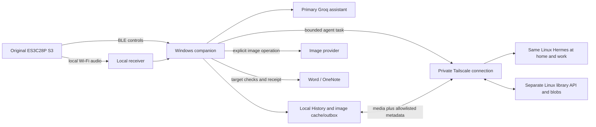

# Classroom companion: consolidated branch programme

21 October 2026 - authoritative current plan for `codex/companion-media-agent`.

The repository has two branches: `main` preserves the stable reference, and `codex/companion-media-agent` contains all current companion, Hermes, SQLite/media-library and deployment development. Continue this work on the companion branch. Temporary implementation and preservation branches have been consolidated; their former histories remain recoverable from the local archive. The original S3 firmware is preserved in a verified private recovery image. Its registration remains write-locked; the explicitly approved local page 7 trial is recorded below.

**Documentation consolidated; product candidate implemented in part; deployment and classroom acceptance remain open.** This plan supersedes earlier roadmaps and resolves later hardware/network decisions. Historical implementation and research records retain their original evidence. Updating this plan does not deploy services, charge an image account, unlock a board or approve a release.

24 October 2026 checkpoint: the companion branch has reconciled core `main` fixes from `4f07c0b`, retaining protected feature configuration and insertion guards. Fresh automated checks and a native desktop launch passed; the registered S3 was checked read-only at home. See [the reconciliation record](2026-10-21-hermes-integration-checkpoint.md#main-reconciliation-24-october-2026). Deployment and physical/classroom acceptance gates remain open.

Subsequent [home acceptance](2026-10-24-home-acceptance.md) records user-confirmed Word writing/image, History and restart passes. OneNote text works. Unsupported selection inspection initially blocked image insertion; the visible-feedback fix passed a physical handheld retest, and manual copy/paste was verified. M5 remains incomplete.

The user then approved normal OneNote Ctrl+V semantics for an explicit Paste Ready gesture when selection inspection is unavailable. The native-canvas-bound keyboard-paste path is implemented. After restarting, the user confirmed that one physical handheld Paste Ready press inserts one new image correctly, followed by successful undo, redo and save/reopen checks. Background OneNote insertion stays restricted. See the follow-up in the home acceptance record.

## Outcome and fixed decisions

24 October 2026 device follow-up: the user explicitly approved the Dedicated
actions layout and flashing a recoverable original-S3 trial. The application-only
write and independent read-back passed; USB identity/status acknowledgements
passed, and the user confirmed the new layout, Library action and generated
kangaroo insertion through physical Paste Ready in Word. The original
16 MiB recovery image matched two complete device reads. The stable registry and
`main` remain unchanged. See [Create & Paste device trial](2026-10-24-create-paste-device-trial.md).
Other new-firmware button/workflow, microphone and classroom gates remain open.

Build an accessible, openly distributable presentation companion: a teacher asks for text, a saved image, a new/refined image or a supported device change; the desktop performs bounded actions, retains useful work and explains progress. Preserve existing Compose, Dictate, Paste Ready, shortcuts, receiver and speech capabilities.

| Decision | Binding scope |
| --- | --- |
| Hardware | ES3C28P ESP32-S3 only: 16 MB flash, configured 8 MB PSRAM, existing capacitive touch/audio. Abandon the CYD application port; retain diagnostic history and wrong-board safeguards. |
| Stability | Original installed firmware and main remain the reference. Desktop development stays isolated. A hardware trial needs an explicit user decision, verified recovery backup and reviewed write-role change; choosing the S3 does not unlock it. |
| Agent roles | Embedded Groq stays primary. Integrate the existing Linux Hermes for this installation through a permanent private Tailscale route at both home and work. Other teachers can use the core product without Hermes. |
| Network | Same Linux Hermes and stable private endpoint in both locations. Tailscale is a required delivery milestone. Windows, not the ESP32, is the Tailscale client/bridge. |
| Media hosting | Separate application-owned library API on Linux; separate token, storage and lifecycle from Hermes. Neither Hermes memory nor its conversation database is the library. |
| First destinations | Word and OneNote desktop first; PowerPoint after their acceptance gates. |
| Teaching workflow | Prepared library is default; live generation available. PC microphone first, then physical handheld microphone into the same workflow. |
| Retrieval/insertion | Library first; web only when requested. Insert retrieved items on explicit request into an unchanged target; generated images require preview. Changed/uncertain destinations remain queued. |
| Versions | Explicitly name/approve a canonical version. Refinement creates immutable child versions; prior approved images remain available and revertible. |
| Private sync | Automatic home/work media-and-metadata sync is required in the first complete image release. History, full prompts, conversations, credentials, jobs and network settings remain local. |
| Images/spend | Selectable image producers, starting with Google Nano Banana 2.1 while retaining quality review and the existing OpenAI adapter. A$30 monthly pilot design allowance. Shared reservations are estimates, not invoices or a guaranteed billing cap. Authorised twelve-attempt home trial completed: ten saved images, two retained failed attempts; A$2.40 allocated, actual invoice unverified. |
| Later capabilities | Runtime controls, deeper administration, reviewed code updates, PowerPoint, audio/video, installation and public adoption follow the accepted image workflow. Preserve functionality throughout. |

## Current implementation and verification limits

These are recorded results, not tests rerun during this documentation pass. Counts describe different suites/checkpoints; do not add them into a claimed unified release result.

| Capability | Candidate/evidence | Still required |
| --- | --- | --- |
| Ask/Manage and text History | Groq/Ollama assistant; bounded status, opt-in History search and save-text tools; local request/response History. | Broader administration, durable cross-session conversation UX and teacher acceptance. History is not synced. |
| Image library | Separate media schema v2, validated blobs, immutable lineage, canonical pointer, search, backup/restore and conflict UI. History schema v1 preserved. | Real library workflow, interrupted recovery, retention/deletion acceptance. |
| Image tools | Explicit library/web intents; Commons retrieval and OpenAI/Gemini generation/edit adapters; frozen preparation, preview, local receipts/timings and uncertainty states. Real Gemini generation and four refinements passed after correcting the delivery-mode rejection. Native button-to-preview measured; private backup/restore verified. | Teacher quality review, provider invoice reconciliation and physical generated-image Office acceptance. See [live trial](2026-10-24-gemini-live-trial.md). |
| Insertion | Guarded Word COM and OneNote UI Automation/clipboard adapters. Hidden synthetic Word save/reopen passed. | Real foreground/caret/selection/undo/save-reopen on supported editions. A paste request is not embedding/save proof. |
| Sync/budget | Authenticated allowlisted library API, local outbox/cache, revisions/conflicts, shared AUD reservations and automatic sync worker. | Persistent Linux deployment, HTTPS, restore and two actual Windows installations across locations. Loopback convergence is not that proof. |
| Voice | Existing PC speech path and authenticated receiver-to-media-job bridge. | Both physical microphones, unchanged text workflow and original S3 acceptance. |
| Hermes | Runtime adapter and explicit task UI now implemented: DPAPI settings, bounded previews/runs/events/cancel/results, durable identities and terminal-state recovery. Development skill remains separate. | Same-host private HTTPS/Tailscale deployment, off-LAN and real task acceptance. Local fixtures do not establish deployment. |
| Isolation/safety | Separate launch/data/receiver ports; hardware inputs default off. 26 guard tests plus physical wrong-board/stable-lock rejection; test upload only to CYD diagnostic. | Approved S3 trial/recovery when firmware changes are necessary. Installed S3 firmware remains unchanged. |
| Local QA | 164 integrated feature tests, native UI previews, synthetic DPAPI roundtrip and 4 portable Linux server tests recorded. | Release matrix and classroom acceptance. Neither main merge nor live deployment is established. |

Evidence: [implementation record](2026-10-21-media-feature-implementation.md), [board safeguards](board-upload-safety.md), [historical CYD inspection](2026-10-21-second-board-inspection.md). Source: `tools/compose/`, `server/media_library_server.py`, `tools/board_safety.py` and Hermes skill scripts.

## Architecture and ownership

The companion owns Windows cursor/clipboard actions, permissions, local credentials, jobs and user approval. Models propose intents; application code validates/performs them. Hermes runs on Linux and cannot inherently operate a Windows caret or bypass the upload guard. Image-provider calls, Hermes dispatch, sync and flashing have separate actions, status and receipts.

Permanent connection means persistent configuration, restart recovery and cross-network acceptance. It does not mean automatically forwarding conversations, running unsolicited maintenance or treating HTTP 200 as readiness. Local-only mode makes no remote calls. Normal Groq mode may require internet when Hermes is unavailable. Cached retrieval and existing BLE controls remain independently usable.

See [home/work architecture](home-work-architecture.md) and [permanent Hermes/Tailscale runbook](hermes-tailscale-home-work.md).

## Teacher workflow

1. Launch the isolated companion; show local/Groq/Hermes/library status independently. Keep Ask/write and Manage distinct. Explain actions without requiring teachers to understand agent infrastructure.
2. Speak through PC/handheld microphone or type. Preserve text actions. Convert media requests to durable bounded intents; library lookup is deterministic application work.
3. “Find our water-cycle image” searches saved versions/canonical images first. No match does not silently become paid generation or web search.
4. Explicit generation/refinement shows brief/provider and estimated allowance use, reserves through the shared ledger before dispatch, and retains operation identity. Ambiguous outcomes enter review; never replay a paid operation automatically.
5. Preview, refine into child versions, then explicitly keep/name the chosen canonical image. Review scientific accuracy, spelling, accessibility and provenance. Insertion permission and canonical naming are separate.
6. Insert only on explicit request after target verification; otherwise queue for Paste Ready. Word/OneNote report the actual verification level. Never blindly retry uncertain insertion.
7. Commit locally, then sync only allowlisted media/version metadata. Preserve competing canonical choices for explicit resolution. Show local, queued, synced, conflict and unavailable states.
8. “Fix the connection” or “add a shortcut” uses capability-specific support/configuration tools. Code changes go through an isolated worker, tests, review and recoverable release; a model cannot overwrite running applications or stable firmware directly.

## Ordered delivery backlog

Each milestone closes only with the evidence below. Work proceeds in reversible slices on this feature branch. M1–M6 define the first complete image release. M7–M9 are later programme increments, not quietly included in its acceptance claim.

| ID | Delivery slice | State now | Completion evidence |
| --- | --- | --- | --- |
| M0 | Consolidate scope, decision register, document map and hardware policy. | Complete in this documentation update. | Active guides agree on S3-only scope, Groq primary, permanent Hermes route, local data boundaries and open gates. |
| M1 | Permanent Tailscale transport to existing Linux Hermes: inventory host/versions, private HTTPS, restart persistence, scoped access and safe endpoint migration. | Migration and deployment tooling implemented; private HTTPS route not deployed/accepted. | Same authenticated host from home and off-LAN hotspot/work; restart, denial, outage, reconnection and revocation tests; private configuration and rollback recorded. |
| M2 | In-app Hermes adapter: protected settings/test/status, bounded runs/events/cancel, application knowledge/capabilities and result states. Reuse proven client semantics. | Runtime adapter/UI and offline/native checks implemented; permanent-route acceptance open. | Selected tasks use permanent endpoint; Ask stays Groq; no implicit History transfer, duplicate dispatch or unrestricted shell/SQL authority. Local-only/offline tests pass. |
| M3 | Deploy separate Linux media/budget service with durable storage, ownership, HTTPS and backups; finish setup/conflict/recovery UX. | Server/client and deployment kit implemented; tested backup/restore with fresh HTTP retrieval; live deployment missing. | Two actual Windows stores converge; offline versions/conflicts retained; restart/backup restore proven; no History/prompts/secrets transferred. |
| M4 | Image conversation: retrieval, generation, refinement, naming, previews, recovery and budget UX. | OpenAI/Gemini candidates and [G1–G4 workflow](2026-10-24-image-provider-g3-g4-implementation.md) implemented; G5 readiness passed. [Authorised G6 provider trial](2026-10-24-gemini-live-trial.md) saved ten images including four refinements. Native preview, durable parents and verified private backup/restore passed. | Failed allocations/provider invoice reconciliation, teacher quality and physical generated-image acceptance remain open. Teacher completes water-cycle workflow; versions survive edits/restarts; receipts reconcile; ambiguous failure safe. |
| M5 | Accept Word/OneNote and both microphones with existing S3 functionality. Prefer unchanged installed firmware for host-side tests. | Home Word/PC-microphone, History, image and restart checks passed. Explicit handheld OneNote image insertion, undo/redo and save/reopen user-confirmed after the approved Ctrl+V change. Handheld audio and remaining guards open. | Disposable documents prove placement/selection/focus change/undo/save-reopen; both microphones; no duplicate listeners; S3 regression checks accepted. |
| M6 | Package/pilot first complete image release. | Verified source-preview install/update/rollback/removal exists; signed packaging and teacher pilot remain open. | Repeatable Windows install/update/uninstall, accessible controls, school permissions/network acceptance, two-location lesson rehearsal, support/rollback; image gates signed off. |
| M7 | Agent administration and runtime S3 controls: shortcut/button/profile schema, capabilities, previews, expected revisions, device acknowledgement and rollback. | Create & Paste controls, opt-in identity-bound USB display feedback and scoped application trial/recovery implemented. Live page/status acknowledgement and user-reported layout/Library pass. General runtime profile editing remains design. | Broader physical button/workflow acceptance, wireless feedback and validated runtime profile changes. Firmware changes retain explicit approval and verified recovery gates. |
| M8 | Reviewed code-update worker, PowerPoint, then audio/video library and target-specific insertion. | Future work. | Patches isolated/tested/reviewed/revertible; app/media matrix proves embedding/link/playback semantics, storage/codec/rights limits and uncertainty handling. |
| M9 | Open-source/public distribution and teacher adoption. | Research/recommendations only. | Ownership/provenance resolved; approved licence map/notices; secret-free generic release/history; reproducible signed packages; quick-start, accessibility/pilot evidence and public-release approval. |

M1 precedes remote Hermes acceptance and deployed sync. M2/M3 can be developed against fixtures while transport is configured. M4/M5 can use synthetic/local assets without paid calls. No firmware update is needed merely for the Windows-to-Linux route. Firmware-dependent work waits for explicit S3 trial approval. Public distribution waits for rights/provenance clearance even if local tests pass. Milestone IDs prioritise engineering work rather than imposing a completely serial schedule: start M9 licensing, onboarding and pilot preparation alongside M1–M6. A cleared public image release need not wait for PowerPoint, audio/video or later device customisation.

## Stable S3 trial and recovery

Choosing the original hardware is not permission to flash it now. Preserve its stable role and firmware. Retain CYD records/guard profile for accidental-target rejection; it is no longer the application test target.

Before an approved S3 trial: identify the physical device through the guard; take a complete private recovery image and fingerprint; retain source/build/partition/configuration metadata; verify an executable restoration procedure; close conflicting listeners; record candidate/user authorisation; review a scoped write role. The implemented `board_trial.py` route grants one candidate-bound application write while leaving the stable registration locked. Keep identity/partition checks active and restore after testing as agreed. A backup file alone does not prove recovery. Follow [board safety](board-upload-safety.md).

## Completion dashboard

Documentation completion does not close implementation/deployment/user gates.

- [x] Consolidated decisions and branch documentation.
- [x] Isolated image candidate and bounded local QA recorded.
- [x] Registered-board identity/stable-write protections implemented/tested.
- [ ] Permanent Tailscale route, persistent services and off-LAN acceptance.
- [x] In-app Hermes adapter with bounded tasks/diagnostics and local fixture/native UI checks.
- [ ] Adapter accepted through the permanent private route with real scoped tasks.
- [ ] Linux media deployment, restore and two-host sync acceptance.
- [ ] Paid image quality/refinement/cost acceptance.
- [ ] Real Word/OneNote insertion and both microphones.
- [ ] Approved S3 trial/recovery where firmware changes are necessary.
- [ ] Installed teacher pilot, accessibility/privacy/school checks and regression acceptance.
- [ ] Later configuration/update/PowerPoint/audio/video increments accepted.
- [ ] Licensing, public packaging and distribution approval.

Latest development evidence and limitations: [Hermes integration checkpoint](2026-10-21-hermes-integration-checkpoint.md), [deployment kit](companion-deployment.md), [source-preview lifecycle](companion-installation.md).

Evidence records need date, component/version, synthetic versus real inputs, result and remaining limit. Unknown checks stay unknown. A programme finish date depends on host/network, Office and provider prerequisites; use these completion gates rather than invent a schedule.

## Choices and release conditions

Resolve Linux host/service/storage/backup ownership and access policy; Office editions; approved work-network use; provider account/model and conservative allocation; retention/accessibility; copyright/licence ownership. They do not prevent documentation or isolated development, but do prevent claiming the corresponding deployment, paid, school or public-release gate.

MIT remains the permissive recommendation for original software, subject to ownership/dependency audit and final user choice; hardware/content need an explicit licence map. This update does not apply licences to uncleared material. See [licensing research](research/2026-10-21-licensing-research.md).

Use the [documentation index](README.md) for current plans/guides versus historical evidence. Current policy supersedes old proposals; historical test results are preserved rather than rewritten as deployment facts.
