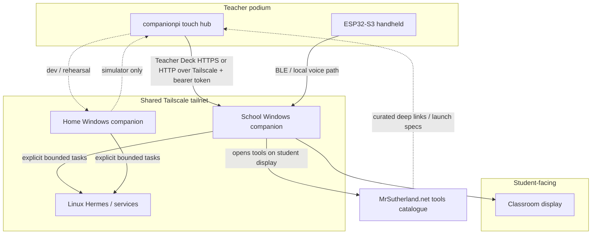

# Classroom Hub Project Brief — Raspberry Pi podium + Tailscale mesh

Prepared 5 November 2026 (Australia/Brisbane).  
Programme governance: [consolidated branch plan](2026-10-21-companion-media-agent-master-plan.md).  
Related plans: [Raspberry Pi Teacher Touchscreen Integration Plan](2026-11-04-raspberry-pi-touchscreen-plan.md), [permanent Hermes/Tailscale runbook](hermes-tailscale-home-work.md), [home/work architecture](home-work-architecture.md).

> **Status language:** This brief is a planning and decision record. It does **not** close local, deployment or classroom acceptance gates. Implemented code and physical bring-up evidence are called out separately from future work.

> **Security & Git boundary:** Private Wi-Fi credentials, SSH host keys, Tailscale auth keys, Teacher Deck bearer tokens, imaging receipts and machine-specific IPs stay in ignored `.local/` paths (especially `.local/raspberry-pi/`). Tracked docs and source use example hostnames, tags and ports only. No public Funnel for classroom control APIs.

---

## 1. Executive summary

Build a **teacher podium hub** on the Raspberry Pi touchscreen (`companionpi`) that:

1. Controls the active classroom Teaching Board and student display without stealing focus from the pupil screen.
2. Reaches **multiple authorised computers** (school Windows PCs, home Windows, Linux Hermes laptop) through one private fabric.
3. Grows into a **catalogue launcher** for the teacher’s presentation tools and MrSutherland.net products, while heavy work continues to run on the destination machines.

**Recommended networking decision:** make **Tailscale the primary control plane** between the Pi and every companion/service host. Treat home/school LAN and mDNS as optional same-room conveniences, not the thing each machine must be reconfigured for. This matches the existing Hermes home/work Tailscale milestone and solves school Wi‑Fi client isolation.

**Recommended product shape:** the Pi remains a **lightweight control surface**. Windows (or another designated “active classroom host”) remains the authority for Teaching Board session state, Office/monitor placement, media stores and credentials. Hermes and website-backed tools stay on their existing hosts; the hub sends authenticated commands and shows status.

---

## 2. Problem statement

### 2.1 Classroom friction today

During a lesson the teacher needs simultaneous access to:

- Teaching Board pages, freeze/live state, undo/redo
- Generated or library image candidates to place on the board
- Student-display targets (Board, OneNote, Word, Chrome, later website tools)
- Mobile ESP32-S3 controls for walking the room
- Occasional agent/Hermes assistance and other curriculum tools on MrSutherland.net

Doing that by alt-tabbing on the classroom PC disrupts the pupil view and slows presentation. The Pi touchscreen is meant to be the glanceable podium surface for those choices.

### 2.2 Multi-computer reality

The same teacher operates across:

| Machine class | Typical role |
| --- | --- |
| School Windows PC(s) | Student display host; Teaching Board; Office |
| Home Windows PC | Development, Unified Desktop, Teacher Deck simulation |
| Linux laptop / Hermes host | Bounded agent tasks over private HTTPS |
| Raspberry Pi 3B + 14″ touch | Podium hub UI at the teaching station |
| Phone / hotspot | Internet path only; not the Tailscale bridge for this design |

LAN addresses, SSIDs and AP isolation differ by site. Binding the hub to “the current LAN IP” creates brittle per-room configuration. All of these computers can already share one Tailscale account/tailnet; that is the stable identity layer.

### 2.3 Product ambition beyond the first deck

The long-term hub is not only “Teaching Board remote”. It should become the teacher’s **presentation switchboard**: select Teaching Board actions, classroom apps, and later tools/products published on MrSutherland.net, without turning the Pi into a second full workstation.

---

## 3. Goals and non-goals

### 3.1 Goals

1. **Reliable private connectivity** from `companionpi` to any authorised host on the shared tailnet, at home and at school.
2. **First product slice:** Teacher Deck (staging images, board controls, display switcher) over Tailscale to the active Windows companion.
3. **Selectable active host:** when more than one Windows companion is online, the teacher can choose which machine is the classroom authority for this lesson.
4. **Hub catalogue (later slices):** curated entries for Board, Office apps, Chrome targets, Hermes-assisted actions, and MrSutherland.net tools the teacher uses live in class.
5. **Low Pi footprint:** keep RAM well inside Pi 3B limits; prefer native Qt/PySide6 kiosk over Chromium.
6. **Home developability:** windowed `tools/pi_touchscreen/` simulator against loopback or Tailscale still works without the physical Pi.
7. **Evidence discipline:** separate local tests, Tailscale reachability checks, physical Pi checks, and classroom acceptance.

### 3.2 Non-goals (this programme)

- Running full Teaching Board, Office, or Chromium lesson content **on** the Pi
- Public internet exposure of Teacher Deck / hub APIs (no Tailscale Funnel for these)
- Replacing Groq-primary assistant policy or moving Hermes onto the Pi
- Firmware changes to the ESP32-S3 as part of hub networking
- Claiming school readiness because Tailscale works at home

---

## 4. Users and primary workflows

### 4.1 Primary user

Classroom teacher (owner) presenting to students, standing at a podium with the Pi touchscreen, optionally holding the ESP32-S3 for mobile triggers.

### 4.2 Core workflows (ordered by delivery)

| ID | Workflow | First success looks like |
| --- | --- | --- |
| W1 | Connect hub → active Windows companion over Tailscale | Pi shows “Connected” using MagicDNS URL + bearer token |
| W2 | Stage and place an image on the Teaching Board | Tap candidate → appears in clear space on pupil board; Undo works |
| W3 | Freeze / page / display switch from hub | Student screen follows without teacher alt-tabbing |
| W4 | Survive host sleep / reconnect | Amber waiting state, then automatic resume |
| W5 | Choose among multiple online Windows hosts | Teacher picks “School PC A” vs “Home sim” explicitly |
| W6 | Launch a catalogue tool (website / app) | Hub sends open/switch command; destination host performs it |
| W7 | Request bounded Hermes help via hub | Hub triggers Windows→Hermes path already governed by Tailscale runbook |

ESP32 voice/buttons remain complementary mobility controls; they do not replace the podium hub.

---

## 5. Current baseline (verified vs planned)

### 5.1 Already present in the repository (implemented code, gates still open)

- Windows Teacher Deck API and models: `tools/compose/teacher_deck_server.py`, `teacher_deck_models.py`
- Pi client package: `tools/pi_touchscreen/` (`deck_ui.py`, `deck_client.py`, systemd unit template, example config)
- Integration plan for first deck UI/API: [2026-11-04 plan](2026-11-04-raspberry-pi-touchscreen-plan.md)
- Hermes Tailscale permanent-route programme (deployment still pending): [runbook](hermes-tailscale-home-work.md)

### 5.2 Physical bring-up progress (5 November 2026, home)

Recorded for planning continuity; **not** Gate 2/3 closure:

- Pi 3B `companionpi` rebuilt on Raspberry Pi OS Lite 64-bit (Trixie); SSH key login verified earlier
- Showscren HD-140 HDMI picture + USB-A→USB-C touch HID enumerated (`wch.cn TouchScreen`)
- Temporary full desktop (`rpd-wayland-core`) installed to prove touch mapping; intended long-term runtime remains light kiosk
- Competing/failed early kiosk unit was disabled during desktop bring-up
- Partial `tools/pi_touchscreen` tree already exists under `/home/companion/esp32-project` on the Pi

### 5.3 Known technical gaps before first Tailscale smoke

| Gap | Why it matters |
| --- | --- |
| Teacher Deck defaults to `127.0.0.1` | Pi cannot reach loopback on another machine |
| Pi config still example-oriented (`companion-pc.local`, placeholder token) | Need MagicDNS host + real shared secret in `.local` only |
| Pi missing intended kiosk stack (`cage` + PySide6) as accepted appliance path | Desktop bring-up ≠ product runtime |
| Tailscale not yet an accepted enrolment on the Pi | Mesh identity missing |
| Active-host selection UI/API not designed | Multi-PC ambition needs an explicit model |
| MrSutherland.net catalogue not specified | Needs curated registry, not scraping the live site ad hoc |

---

## 6. Decision register

| Decision | Choice | Rationale |
| --- | --- | --- |
| D1 Control-plane network | **Tailscale primary** | Stable multi-site identity; defeats school AP isolation; aligns with Hermes route |
| D2 LAN / mDNS | Optional secondary | Useful when same L2 network; never required for configuration truth |
| D3 Pi role | Control surface / launcher | Fits 1 GB Pi; preserves single session authority on Windows |
| D4 First API host | Windows companion Teacher Deck | Code already exists; owns Board/Office/display |
| D5 Auth model | Tailnet membership **plus** bearer token (and later tighter ACLs/tags) | VPN ≠ application authorisation |
| D6 Public exposure | Denied for hub control APIs | Classroom commands must stay private |
| D7 Website tools | Catalogue entries that command a host to open/use them | Pi does not become a browser appliance for every tool |
| D8 Display runtime | Prefer `cage` + PySide6 kiosk after smoke; desktop only for bring-up | RAM and appliance behaviour |
| D9 Secrets location | `.local/` only | Matches project safety rules |

---

## 7. Architecture

### 7.1 Logical topology



### 7.2 Authority boundaries

| Concern | Authority |
| --- | --- |
| BoardSession, pages, freeze, undo | Active Windows companion |
| MediaStore / staging tray | Active Windows companion |
| Pupil window / Office / Chrome z-order | Active Windows companion (`MonitorShortcutController` and successors) |
| Hub UI layout, offline waiting screen | Pi |
| Hermes tasks | Linux Hermes via existing Windows adapter + Tailscale runbook |
| Public website content | MrSutherland.net hosting; hub only stores launch descriptors |
| Tailnet membership / ACL policy | Tailnet owner (user), reviewed changes only |

### 7.3 Discovery and addressing

**Recommended binding model**

1. Each Windows companion publishes a Teacher Deck endpoint on its **Tailscale IPv4/IPv6** (or Tailscale Serve HTTPS) using a stable MagicDNS name, e.g. conceptually `http://school-pc.tailnet-name.ts.net:8790` (exact names stay private in `.local` config).
2. The Pi stores:
   - `active_host_id` (human label)
   - `base_url` (MagicDNS URL)
   - `token` (local secret)
3. Optional later: a tiny **host registry** file or companion beacon listing online Teacher Deck peers on the tailnet (health + revision), so the hub can offer a picker without scanning the public internet.

**Not recommended as primary:** hard-coding `192.168.x.y`, relying on school mDNS across isolated Wi‑Fi, or expecting AP-local broadcast discovery.

### 7.4 Transport and TLS options

| Option | Use when | Notes |
| --- | --- | --- |
| **A. HTTP Teacher Deck on Tailscale IP only (near-term)** | Home smoke, early school trial | Simple; rely on tailnet encryption + bearer token; bind to Tailscale interface or carefully scoped listen address |
| **B. Tailscale Serve HTTPS to loopback Teacher Deck (preferred hardening)** | After smoke | Matches Hermes Serve pattern; machine identity via Tailscale certs; app token retained |
| **C. Raw LAN HTTP** | Same desk emergency only | Documented fallback; not default config |

Recommendation: implement **A for first smoke**, design APIs so **B** is a drop-in URL change, then prefer Serve for school acceptance.

### 7.5 Access control

1. **Tailscale ACLs / tags** (policy intent; exact JSON stays private):
   - Tag `tag:classroom-hub` on the Pi
   - Tag `tag:companion-host` on Windows companions
   - Tag `tag:hermes` on Linux Hermes
   - Allow hub → companion Teacher Deck port(s) only
   - Allow companion → Hermes/media ports per existing runbook
   - Deny hub → arbitrary SSH/RDP on all peers unless explicitly needed for admin
2. **Application bearer token** on every Teacher Deck request (already implemented pattern).
3. **Revision checks** on mutating board actions (already in Teacher Deck design).
4. **No Funnel** for these ports.

### 7.6 Pi runtime architecture

Near-term path after networking smoke:

1. Install Tailscale on `companionpi`; enrol into the approved tailnet.
2. Install `python3-pyside6.qtwidgets`, `cage`, and deploy `tools/pi_touchscreen`.
3. Local config in `~/.config/companion-touchscreen/config.json` (git-ignored on device; secrets never committed).
4. Systemd user/system unit starts kiosk UI; shows waiting banner when host unreachable.
5. Retire full desktop as the default boot target once kiosk Gate 2 passes (desktop may remain installed for maintenance).

Memory budget target for kiosk path: **well under 250 MB** resident for UI + OS headroom on 1 GB hardware (aligns with prior plan Gate 2).

---

## 8. Product surface: hub catalogue

### 8.1 Information architecture (Pi UI)

Suggested top-level areas (progressive disclosure):

1. **Board** — staging, pages, freeze, undo/redo (first slice; existing deck UI)
2. **Displays** — Board / OneNote / Word / Chrome / future targets
3. **Tools** — curated catalogue (MrSutherland.net + local apps)
4. **Hosts** — which companion is active; connection health
5. **Assist** — bounded Hermes/Groq actions exposed deliberately (not a free chat wall)

### 8.2 Catalogue entry model (planned schema)

Each tool entry is a small descriptor, not a live scrape:

```json
{
  "id": "mcs-year5",
  "title": "Maths Command Station",
  "source": "mrsutherland",
  "kind": "web_app",
  "launch": {
    "action": "open_url",
    "url": "https://mrsutherland.net/...",
    "display_target": "chrome"
  },
  "requires": ["active_companion"],
  "tags": ["maths", "year5"]
}
```

Launch actions are executed **by the active companion**, for example:

- `open_url` → Chrome/profile on student display
- `switch_display` → existing display switcher
- `board_control` / `present_image` → Teacher Deck
- `hermes_task` → Windows adapter to Linux Hermes (separate acceptance)

The curated registry can live as tracked JSON/YAML in-repo for open tools, with optional private overlays in `.local/` for school-only URLs.

### 8.3 Relationship to MrSutherland.net

| Layer | Responsibility |
| --- | --- |
| Website | Hosts the actual student/teacher web tools |
| Hub catalogue | Teacher-facing index of what to open during a lesson |
| Active companion | Performs the open/switch on the student-facing machine |
| Pi | Selection UI + status only |

This avoids turning the 14″ Pi into a general browser for every product while still making the podium the place those products are chosen.

---

## 9. Phased delivery plan

### Phase H0 — Brief and baselines (this document)

- Capture Tailscale-first hub decision and multi-host ambition.
- Keep [2026-11-04 touchscreen plan](2026-11-04-raspberry-pi-touchscreen-plan.md) as the detailed Teacher Deck UI/API build plan; this brief governs networking + hub expansion.

### Phase H1 — Tailscale foundation on the Pi

**Deliverables**

- Tailscale installed and enrolled on `companionpi`
- MagicDNS name recorded privately in `.local/raspberry-pi/`
- ACL/tag proposal drafted (private policy change owned by user)
- Documented connect/disconnect checks from Pi → Windows Tailscale IP

**Exit check:** `tailscale status` healthy on Pi; ping/curl to Windows Tailscale address succeeds from Pi; failure modes recorded (offline host, ACL deny).

### Phase H2 — Teacher Deck over Tailscale smoke (home)

**Deliverables**

- Windows companion can bind/advertise Teacher Deck beyond loopback (Tailscale interface or Serve)
- Pi config points at MagicDNS URL + real token (local only)
- PySide6 client runs on Pi (windowed on desktop first, then kiosk)
- One successful present-image and one display-switch path

**Exit check:** Gate 1-style windowed tests still pass on Windows; home physical smoke recorded separately from school acceptance.

### Phase H3 — Appliance hardening on Pi

**Deliverables**

- `cage` kiosk systemd path restored/stabilised
- Boot-to-deck waiting screen
- Memory/throttle snapshot under load
- Touch calibration notes for Showscren HD-140 (known odd physical-size reporting)

**Exit check:** Gate 2 criteria from the Nov 4 plan, updated for 14″ panel geometry.

### Phase H4 — Multi-host selection

**Deliverables**

- Host registry (static config first; optional discovery later)
- Hub UI: list online/offline companions; choose active host
- Clear labelling so school presentation never silently targets a home PC

**Exit check:** With two Windows companions online, teacher can switch targets deliberately; wrong-host protection messages are clear.

### Phase H5 — Tools catalogue v1

**Deliverables**

- Tracked catalogue schema + initial MrSutherland.net entries the teacher actually uses in class
- Companion launch actions for `open_url` / display target
- Hub Tools tab MVP

**Exit check:** From the Pi, open at least two real class tools onto the student display via the active companion.

### Phase H6 — Assist integrations

**Deliverables**

- Hub entries that trigger already-accepted companion→Hermes flows
- No new Hermes deployment claims beyond [runbook](hermes-tailscale-home-work.md) evidence

**Exit check:** Bounded task from hub visible in companion; off-LAN/school still gated by Hermes Tailscale acceptance.

### Phase H7 — School classroom acceptance

**Deliverables**

- School Wi‑Fi or Ethernet path for Pi internet/Tailscale
- Full lesson rehearsal: ESP32 mobility + Pi podium + student display
- Support/rollback notes in `.local/raspberry-pi/`

**Exit check:** Gate 3 classroom acceptance recorded; documentation alone insufficient.

---

## 10. Workstreams and ownership

| Workstream | Owns | Notes |
| --- | --- | --- |
| WS-Net | Tailscale enrolment, ACLs, Serve | User owns tailnet policy approvals |
| WS-Deck-API | Windows listen/bind, token lifecycle, Serve | Extends existing `teacher_deck_server` |
| WS-Pi-UI | `tools/pi_touchscreen`, kiosk unit | Keep windowed simulator working |
| WS-Catalogue | Tool registry + Tools tab | Start curated, small |
| WS-Hermes | Reuse permanent route programme | Do not fork a Pi-native Hermes client |
| WS-Safety | Secrets, `.local/`, no Funnel | Continuous |

Firmware/board-safety rules remain unchanged and out of scope unless a later hub feature explicitly needs a device trial.

---

## 11. Configuration shape (non-secret examples)

### 11.1 Pi `config.json` (conceptual)

```json
{
  "active_host_id": "school-main",
  "hosts": [
    {
      "id": "school-main",
      "label": "School classroom PC",
      "url": "http://school-pc.example.ts.net:8790",
      "role": "companion"
    },
    {
      "id": "home-dev",
      "label": "Home development PC",
      "url": "http://home-pc.example.ts.net:8790",
      "role": "companion"
    }
  ],
  "token": "REPLACE_WITH_LOCAL_TEACHER_DECK_TOKEN",
  "kiosk": true,
  "windowed": false,
  "width": 1920,
  "height": 1200,
  "poll_ms": 1000,
  "transport": "tailscale"
}
```

Exact hostnames/tokens remain private. Example `ts.net` names above are illustrative only.

### 11.2 Windows companion settings (conceptual)

- `teacher_deck.enabled`: true when presenting
- `teacher_deck.bind`: `tailscale` | `loopback` | `lan`
- `teacher_deck.port`: `8790`
- `teacher_deck.token`: DPAPI-protected or other existing protected-settings pattern
- Optional Serve hostname recorded privately

---

## 12. Risks and mitigations

| Risk | Impact | Mitigation |
| --- | --- | --- |
| School blocks Tailscale | Hub cannot reach companion | Detect early; Ethernet/USB fallback; hotspot with Tailscale on both ends |
| Wrong active host selected | Actions hit home PC during class | Explicit host picker; large on-screen host label; confirm on switch |
| Pi 3B OOM if Chromium catalogue used | Lesson failure | Keep native UI; thumbnails only; no general browser kiosk |
| Token leakage via logs/git | Security incident | Existing no-log patterns; `.local/` only; rotate token |
| Full desktop left as default | RAM/noise/support burden | Time-box desktop to bring-up; return to kiosk for Gate 2 |
| Scope creep into “second computer” | Delayed classroom value | Ship W1–W3 before catalogue breadth |
| Hermes route unfinished | Assist tab empty | Keep Assist behind Hermes acceptance; Board hub still valuable |
| Touch calibration drift on 14″ panel | Mis-taps | Capture calibration matrix after kiosk; keep mouse-emulation mapping |

---

## 13. Acceptance gates (programme-level)

These extend, not replace, the Nov 4 Gate 1–3 language.

| Gate | Evidence required | Not sufficient |
| --- | --- | --- |
| **G-H1 Mesh** | Pi and at least one Windows companion online on same tailnet; Pi curls Teacher Deck health/auth endpoints via MagicDNS | Tailscale “connected” icon alone |
| **G-H2 Smoke** | Present-image + display switch from physical Pi at home | Windowed simulator only |
| **G-H3 Appliance** | Boot to kiosk deck; memory/throttle budgets; touch usable | Full desktop workaround |
| **G-H4 Multi-host** | Deliberate switch between two live companions | Config file edited by hand mid-lesson |
| **G-H5 Catalogue** | Two real tools opened onto student display from Tools tab | Links that only open on the Pi |
| **G-H6 Classroom** | Full period rehearsal at school with ESP32 + hub + pupil display | Home Tailscale success |

---

## 14. Immediate recommended next actions

1. Enrol `companionpi` in the approved Tailscale tailnet; record MagicDNS name privately.
2. Add a Windows companion setting to bind Teacher Deck to Tailscale (or Serve) instead of loopback-only.
3. Point Pi local config at that URL with a real token; run a manual PySide6 client smoke on the existing desktop.
4. Only after smoke: restore kiosk unit and chase Gate 2 appliance behaviour.
5. Draft a short curated Tools catalogue (5–10 entries the teacher actually uses) before building a large UI.

---

## 15. Document control

| Item | Value |
| --- | --- |
| Title | Classroom Hub Project Brief — Raspberry Pi podium + Tailscale mesh |
| Date | 5 November 2026 |
| Supersedes | Networking “fallback” framing in §Phase 3 of the 4 November touchscreen plan for **new** work; that plan remains authoritative for Teacher Deck UI/API detail |
| Companion private ops | `.local/raspberry-pi/HANDOFF.md` and related receipts (ignored) |
| Update trigger | First Tailscale smoke result; ACL decision; kiosk Gate 2; school trial |

---

## 16. Open questions for the owner

1. Preferred Tailscale naming scheme for school vs home Windows companions?
2. Accept near-term HTTP-on-tailnet for smoke, or require Serve HTTPS before any school trial?
3. Should the first Tools catalogue be a tracked in-repo list, a private `.local` overlay, or both?
4. Is the Pi intended to stay permanently at school only, or also travel home for development (affects enrolment and SSD/card ops)?
5. Which MrSutherland.net tools are must-have for the first classroom catalogue (name the first five)?
