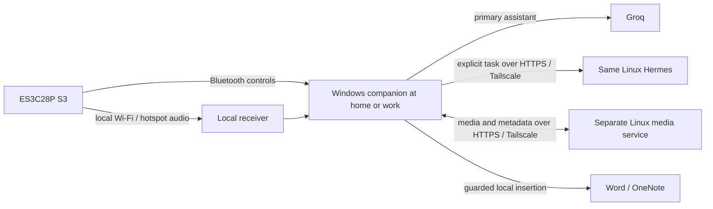

# Home/work architecture

21 October 2026 — current target architecture; see the [master plan](2026-10-21-companion-media-agent-master-plan.md) for implementation status.

## One handheld, same personal agent

Use the original ES3C28P ESP32-S3. Preserve installed stable firmware/write lock until an approved recoverable trial. The CYD application port is abandoned; keep diagnostic records and upload safeguards.

At home and work, Windows will reach the same Linux Hermes through a permanent private Tailscale endpoint. Groq remains the primary embedded assistant. A separate Linux library API synchronises images/allowlisted metadata. The permanent route and in-app Hermes adapter are still deployment/implementation milestones, not accepted current features.

Tailscale runs on Windows and Linux, not on the handheld. Local device profiles can differ while the remote Hermes identity stays the same. Moving locations must not require a reflash merely because a LAN address changes.

| Layer | Owns | Current limit |
| --- | --- | --- |
| S3 | Controls, touch, capture, existing environment selections | Stable installation unchanged; new firmware requires trial approval. |
| Windows | Groq/Ollama, local History/cache/jobs, permissions and Office insertion | Image candidate exists; physical target/microphone acceptance open. |
| Local receiver | Authenticated audio/transcription/local handoff | Feature bridge implemented; physical acceptance open. |
| Linux Hermes | Explicit bounded remote work | Historical LAN consultation; permanent route/product adapter pending. |
| Linux library | Versions, blobs, conflicts and budget authority | Portable candidate tested; persistent deployment/two-host acceptance pending. |

Production receiver routing remains legacy behaviour. Do not relocate/reconfigure the running receiver merely to match this diagram. Stage the new route in isolation first.

## Connectivity and independent readiness

Keep local Wi-Fi credentials/receiver URLs/tokens together in device profiles; keep private remote origins in Windows protected settings. Phone hotspot supplies internet/local networking; the Windows Tailscale client supplies the remote route.

BLE controls, local capture/transcription, Groq, Hermes, library sync and image-provider readiness are separate. Wi-Fi alone does not prove voice readiness. HTTP liveness does not prove model/tool readiness. Remote services need connectivity; explicit local Whisper/Ollama and cached assets can remain usable offline. Local-only mode suppresses private-tailnet traffic too.

Original receiver TCP 8787 remains separate from preview TCP 8788/discovery UDP 8789 until an approved trial. Start preview with hardware inputs off. Two companions sharing global shortcuts are not isolated by using another handheld; coordinate listener ownership.

## Data and credentials

Separate receiver/Hermes/library/provider secrets. Use application authentication behind private HTTPS and scoped access, without public Funnel/port-forwarding. Sync validated media/metadata only; History, full prompts, secrets, settings and jobs remain local. Never synchronise live SQLite files.

Operational guides: [permanent connection](hermes-tailscale-home-work.md), [media server](media-sync-server.md), [acceptance tests](feature-media-testing.md), [board safety](board-upload-safety.md). This topology is a target, not proof of deployed services.
